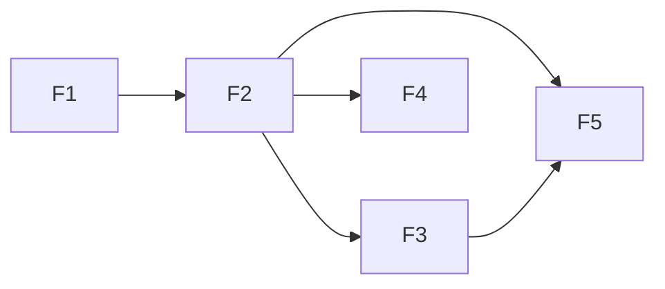

# Personal software factory, v1

Written 2026-11-24. The plan is a checklist an owner runs box by box. It is not the code.

The tools live in this repository at `bin/`. From `/home/sumeet/personal-repo` they are also
reachable as `bin/verify`, `bin/context-doctor`, and `bin/install-gate` through symlinks, so
the paths in the boxes below work from either place.

## What changes

Today most work lands straight on trunk, and the three busiest repositories have no CI at
all. After v1, every commit in the active repositories goes through a pull request whose
required check lives on GitHub, a local script reaches the same verdict in minutes before
push, and a weekly scoreboard reads both to show whether velocity rose while quality held.

Five artifacts, in this order.

| id | change | depends on | review gated |
| --- | --- | --- | --- |
| F1 | a `factory` contract block in every `AGENTS.md`, plus `bin/context-doctor` | none | no |
| F2 | `bin/verify` runs the block, writes a receipt | F1 | no |
| F3 | required GitHub check plus branch protection on 4 repos | F2 | yes, changes your daily habit |
| F4 | `bin/factory-report` prints four numbers with the baseline beside them | F2 | no |
| F5 | six lines in the home `AGENTS.md` that bind agents to the gate | F2, F3 | yes |



The shape comes from the report's own loop. Context is F1, execution is F2, governance is F3,
measurement is F4. F5 is what keeps the loop closed after the session ends.

## Baseline measured today

| number | value | how measured |
| --- | --- | --- |
| commits, last 30 days, 22 repos | 275 | `git rev-list --count --since=30.days` |
| merged PRs, last 30 days | 26 | `gh pr list --state merged --search merged:>=2026-10-25` |
| commits that bypassed a PR | about 90% | 26 PRs against 275 commits |
| repositories with a CI workflow | 6 of 22 | `.github/workflows` |
| repositories with `AGENTS.md` | 10 of 22 | file present |
| reverts, last 90 days | 0 | `git log --grep '^Revert' -i` |
| fix commits, last 90 days | 39 of 315, 12.4% | `git log --grep '^fix' -i` |

Reverts are zero because nobody labels a revert, so that number carries no signal. The
fix-commit share is the usable guard, and it is a proxy for quality, not a measurement of it.
Every report says so.

Toolchains differ, which decides F1's design. `lore` is Python, `healthOraa` is pnpm with
turbo, `veltr` is npm, `caver-ci` is npm, `ilvuno` is a Makefile, `ilvuno-second` is Cargo.
No detector guesses all six correctly, so the commands get written down once, in the repo,
and the gate reads that file instead of guessing.

## Targets, 30 days after F5

| number | from | to | guard |
| --- | --- | --- | --- |
| commits on the 4 active repos that arrive by PR | about 10% | 100% | none, this is the point |
| merged PRs per week, 4 active repos | about 4.9 | 8 | fix-commit share at or under 15% |
| repos with a contract block whose commands resolve | 5 of 22 | 21 of 22 | `context-doctor` exits 0 |
| gate verdict before push | absent | under 4 minutes on `lore`, 6 on `ilvuno-second` | the receipt's own wall time |

Two targets are deliberately absent. Test coverage percentage, because it rewards tests that
assert implementation. Lines shipped, because throughput alone is not the goal.

## F1. Context contract

- [x] `bin/context-doctor`, built 2026-11-24
- [x] `bin/lib/factory-block.mjs` parses the block once for both tools, so they cannot drift
- [x] `bin/templates/agents-factory-block.md` documents the format
- [x] blocks landed in `lore`, `caver-ci`, `ilvuno`, `ilvuno-second`, `healthOraa`
- [ ] blocks in the remaining 17 repos, one at a time, each after running its command by hand
- the change. Extend the home `AGENTS.md` convention with one fenced block per repo.

      ```factory
      typecheck: npm run typecheck
      test: npx vitest run
      test1: npx vitest run {file}
      build: npm run build
      ```

      `bin/context-doctor` parses the block, checks each command's first token against the
      repo's own toolchain (`package.json`, `pyproject.toml`, `Cargo.toml`, `Makefile`,
      `go.mod`), resolves explicit paths such as `.venv/bin/pytest`, and prints a per-repo
      table. A block without `test` is invalid. A missing `node_modules`, `.venv`, or `target`
      is a warning, because a fresh clone is not a mistake.
- [x] result you see, measured 2026-11-24. `4 pass, 18 fail of 22`. `lore PASS test`,
      `caver-ci PASS typecheck,test,build`, `ilvuno PASS build,test`,
      `ilvuno-second PASS typecheck,test,build`, `healthOraa FAIL no-test-command`.
- [x] unit. 15 tests in `bin/test/factory.test.mjs`, all passing. They cover the parser, a
      missing script, a missing make target, a wrong-language command, an explicit binary path,
      the doctor exit code, and a contract with no test command.
- [x] live. Each command in the five blocks was run by hand. `lore` pytest, 124 passed in 6.2s.
      `ilvuno` `make test`, 5 packages ok in 13.3s.
- [x] perf. Doctor over 22 repos in under 2 seconds.

Two findings from landing it. `healthOraa` has no test command at all, only `test:e2e` which
needs Playwright browsers, so it cannot be gated until it gains one. `ilvuno-second`'s block is
correct but the Rust toolchain on this machine is broken. `rustc -vV` fails with `missing
manifest in toolchain 'stable'`, so `cargo check` cannot run. `rustup toolchain install
stable` is the fix, and until then `bin/verify projects/ilvuno-second` reports the toolchain
error rather than pretending to pass.

## F2. `bin/verify`

- [x] `bin/verify` and `bin/README.md`, built 2026-11-24
- [x] the change. Reads the repo's `factory` block, runs `typecheck`, `test` (or `test1`),
      `build` in that order, stops at the first failure, and appends one JSON line to
      `~/.local/state/factory/verify.jsonl` with repo, sha, dirty flag, per-command exit and
      duration, total time, and a receipt id. `--json`, `--dry-run`, `--file`, `--state-dir`.
      Contract errors fail before anything runs. There is no skip path.
- [x] result you see, measured. `bin/verify projects/lore` prints `PASS 10556ms receipt
      efddf657a3f2`. Warm rerun `PASS 5764ms receipt e58c47e0aca5`.
- [x] live fail path, proven on the real repo. A deliberately failing test added to
      `projects/lore/tests` produced `FAIL test-failed receipt 2a0588eda8d6` with the pytest
      traceback, then the test was deleted and the next run passed. The receipt for the failure
      records `commands: [test]` and no `build`, which proves the run stops at the first
      failure.
- [x] unit. The same 15 tests cover the fail path, the dry run, `--file` substituting the
      placeholder, and the receipt contents.
- [x] perf. `lore` cold 10.5s, warm 5.8s, against the 4 minute budget.

## F3. The untamperable gate

- [x] `bin/install-gate` and `bin/templates/factory-workflow.yml`, built 2026-11-24
- [x] this repo gated with its own workflow, `.github/workflows/factory.yml`
- [x] branch protection on this repo's `main`, applied 2026-11-24. Required check `factory`,
      strict (branch must be up to date), `enforce_admins: true`, force pushes and deletions
      blocked. Verified with `gh api repos/Sumeet-basfore/prosci/branches/main/protection`,
      which returned `checks: ["factory"], strict: true, admins: true, forcepush: false`.
- [ ] install and protect `lore`, then `healthOraa`, `ilvuno-code`, `caver-ci`
- the change. The workflow checks out this repo beside the target and runs
      `node factory/bin/verify . --state-dir .factory`, then uploads the receipt. One
      implementation serves every repo, and a change to the gate is visible in one place.
- [x] live, on this repo. PR #3's first run failed red with `MODULE_NOT_FOUND` because the
      contract named `node --test bin/test/`, which Node 22 in CI does not scan as a directory.
      Node 26 locally does, so the bug was invisible for two phases and the gate caught it on
      its first run. The contract now names the files and the check went green. That is the
      gate doing its job on the author, before any user was affected.
- [ ] result you see on a target repo. A PR with a deliberately failing test shows a red
      `factory` check and a disabled merge button.
- [x] unit. Four behaviour tests in `bin/test/install-gate.test.mjs` cover the write, the
      refusal to overwrite, the `--owner` override, and the missing-owner refusal. `actionlint`
      is the cheap check before the first push.
- [ ] perf. `gh run view` wall time under 6 minutes on `lore`. This repo's run takes about 10
      seconds, which is the floor, not the target.
- [x] the operator call. It changed the daily habit from commit to branch and PR. Four PRs
      landed under it on 2026-11-24, three phases plus one review fix.
- the caveat. `caver-ci` already has `quality.yml`. Do not add the factory workflow beside it
  and call the gate done, or the repo will have two checks and neither is the contract. Decide
  which one survives first.

## F4. `bin/factory-report`

- [ ] depends on F2
- [ ] files, `bin/factory-report`
- the change. Reads `verify.jsonl` and `gh pr list` for a named repo set. Prints four
      numbers with the baseline beside each, plus the fix-commit share as the guard. Default
      window one week. No database, no dashboard.
- [ ] result you see. `--since=2026-10-25 --baseline` reproduces the baseline table above. That
      is the check that the numbers are real.
- [ ] unit. Fixture JSONL, one pass one fail, plus a stubbed `gh` on `PATH`.
- [ ] live. Compare one printed number against `git rev-list` by hand. If they differ, the
      report is wrong, not git.
- [ ] perf. Under 10 seconds.

## F5. The rule that binds agents

- [ ] depends on F2, F3
- [ ] files, `/home/sumeet/personal-repo/AGENTS.md`
- the change. Six lines. Before a commit, run `bin/verify <repo>` and paste the receipt id
      in the reply. Before a push to a protected repo, open a PR. A failing gate is reported,
      never bypassed. No exceptions clause, because an agent will find it.
- [ ] result you see. On the next real task, the final reply carries a receipt id and the
      `factory` check link.
- [ ] unit. none, it is prose.
- [ ] live. One task end to end on a repo where the gate can fail. Record whether the agent
      tried to work around the gate. Patch what the attempt reveals.
- [ ] review gated. Two rules every future agent obeys. Read the diff before merge.

## What stays unproven

- Whether more PRs is better for you than fewer larger ones. The plan optimises for more
  because you asked for it. If the fix-commit share climbs, the split is wrong, not the gate.
- Whether GitHub Actions is the right outer loop for one person. It is chosen because it runs
  server side where an agent cannot edit it. A `pre-push` hook is cheaper and weaker for
  exactly that reason.
- The active set, `lore`, `healthOraa`, `ilvuno-code`, `caver-ci`, is picked by 30-day commit
  count. Change it in F4 before F3 if your attention moved.
- `veltr-personal` was in that set on commit count, 14 in 30 days, and is out of it because its
  remote does not resolve. `git remote -v` gives `meow687687/veltr-personal`, and `gh repo view`
  on the signed-in account returns `Could not resolve to a Repository`. The local checkout is
  not ahead of its upstream, so the work is pushed somewhere. Find where before counting veltr
  as covered by any of this.
- `ilvuno-second-truth-ui` is a git worktree of `ilvuno-second`, not a separate repo, so its
  `no-block` row is a stale copy of `AGENTS.md` rather than a repo that needs its own contract.
  The doctor counts worktrees today. Give it one row per repository when the count starts to
  matter, which it does once the doctor's exit code becomes a required check.
- Nothing here measures whether the code is good, only whether it builds, passes, and lands
  through a gate. Review still happens or does not. F5 is where that stays visible.
